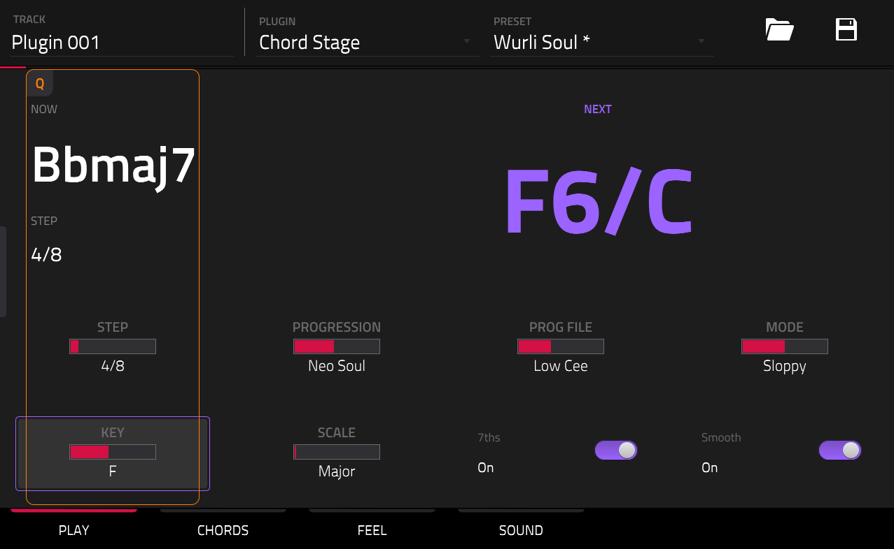
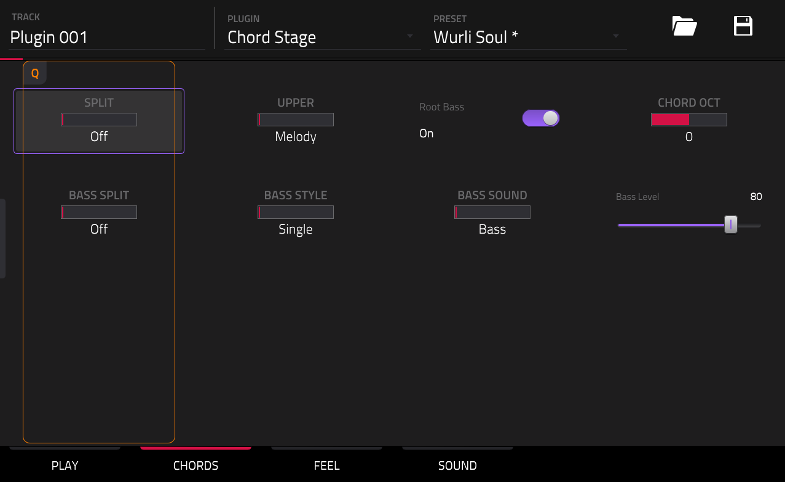
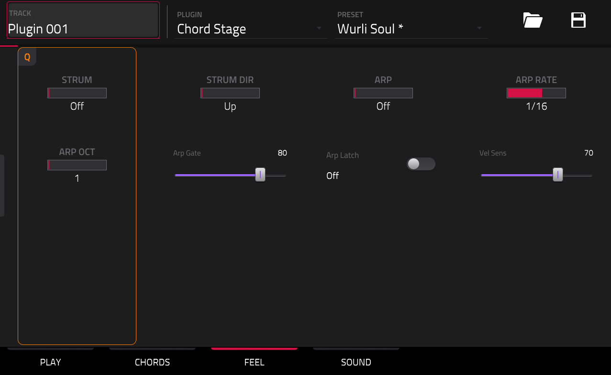
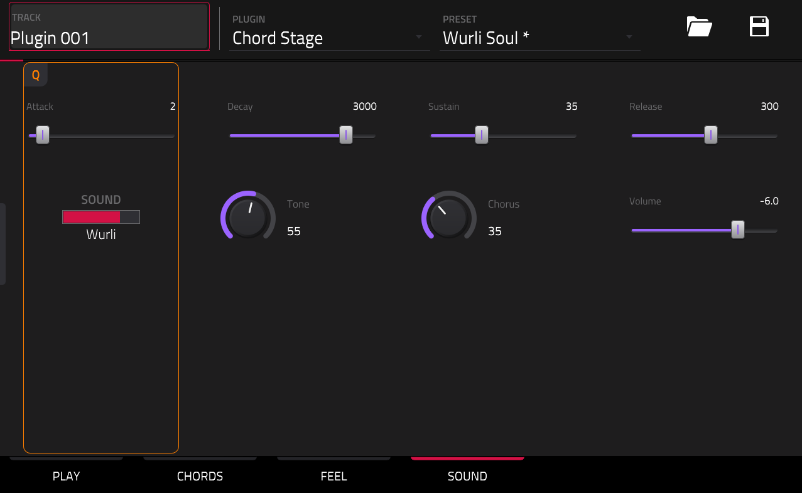

# Chord Stage Help

Chord Stage is a chord helper instrument for the MPC. You play loosely, landing near the right keys, and it plays the right chords in your key with its own sound. It can follow a chord progression and shows you which chord comes next.

This guide covers version 1.3. It is also in the repo as a PDF: `docs/Chord-Stage-Help.pdf`.

## Contents

1. Install and update
2. Quick start
3. The PLAY page
4. The three modes
5. Progressions and progression files
6. The CHORDS page
7. The FEEL page
8. The SOUND page
9. Built-in programs
10. Tips for small keyboards
11. Troubleshooting

## 1. Install and update

**You need** an MPC with MPC OS 3.10.1 or later, with **Preferences → Enhancements (Beta) → Enable Enhancements** and **External Plugin Support** turned on. Restart the MPC after turning them on.

**To install or update:**

1. Put the MPC's SD card (or a USB drive) in your computer.
2. Copy the folder `Germanikkus - VST - Chord Stage` into the `VST2 Plugins` folder at the top of the card. Make `VST2 Plugins` if it isn't there. When updating, copy over the old folder. Your progression files in `Content/Progressions` stay where they are.
3. Put the card back in the MPC.
4. Make a **Plugin** track and pick **Germanikkus → Chord Stage**. Set the track's MIDI input to your keyboard (or All).

After an update, remove Chord Stage from the track and add it again so the MPC loads the new version and its screen.

## 2. Quick start

1. Load the program **EP Chords**, or pick one from the **Preset** menu at the top of the screen.
2. Set **Key** and **Scale** on the PLAY page.
3. Play any key: you hear that key's chord in your key. Wrong notes snap to the nearest note in the key.
4. To follow a progression, pick one with **Progression** (or **Prog File**), set **Mode** to **Sloppy** or **Lock**, and watch **NEXT**: press a key with that chord's root letter.

## 3. The PLAY page

The top half shows what to play:

| Display | What it shows |
|---|---|
| **NOW** | The chord you just played. `-` until you play one. |
| **NEXT** (purple, big) | The chord to play next. With a progression, that's the progression's next chord. Without one, it's a suggestion of a chord that often comes next. |
| **STEP** | Where you are in the progression, for example `4/8`. `-` with no progression. |

The controls below:

| Control | What it does |
|---|---|
| **Step** | Turn it to jump to a step of the progression. It also follows along as you play. Pressing Play from the start of the sequence, changing the progression or changing the Key sends it back to step 1. |
| **Progression** | One of 15 built-in progressions, or None. See section 5. |
| **Prog File** | An MPC `.progression` file from the plugin's folder. While a file is picked, it replaces the Progression. See section 5. |
| **Mode** | Chords, Sloppy or Lock. See section 4. |
| **Key**, **Scale** | The key. Scales: Major, Minor, Harmonic Minor, Dorian, Mixolydian, Major Pentatonic, Minor Pentatonic, Blues. |
| **7ths** | On: each key plays the 7th chord of its scale degree (Cmaj7, Dm7…) instead of the triad. |
| **Smooth** | On: each chord takes the inversion closest to the last one, so the hand (and the sound) moves as little as possible. Off: chords play in root position near the key you pressed. |

**Q-Links:** the orange **Q** frame shows which controls the Q-Link knobs move. Touch a control to move the frame there.

## 4. The three modes

| Mode | A key that matches the next chord | Any other key |
|---|---|---|
| **Chords** | Plays its own chord in the key. If that happens to be the next chord, the progression moves on. | Plays its own chord in the key. |
| **Sloppy** | Plays the progression's chord (with a file, its exact notes) and moves on. | Plays its own chord in the key; the progression waits. |
| **Lock** | Plays the progression's chord and moves on. | Silent. |

**What counts as a match** (Sloppy and Lock):

- The key's letter is the **root** of the next chord: an **A** for `Am7`, a **G** for `G/B`. The root comes from the chord's name, not its lowest note, so `Emin7/B` is played from an **E**.
- A wrong note that snaps to the root counts: C# in C major snaps to C.
- **Near misses count too:** a key a half step either side of the root also plays it. For `Abmin7` in F major, A, Ab and G all work. In Sloppy, an exact hit wins over a near miss.
- **Sloppy** looks two chords ahead, so you can skip a chord. **Lock** only takes the next one.
- In **Lock**, keys pressed within 150 ms after a chord are treated as the same hand landing and stay silent.

**Tip:** Lock is the most forgiving way to play a progression with "not-so-precise" fingers: only the right chord can sound. Sloppy lets you play other chords in the key between progression chords.

## 5. Progressions and progression files

**Built-in progressions** (Roman numerals counted from the major scale):

| Name | Chords |
|---|---|
| Pop | I V vi IV |
| Doo-Wop | I vi IV V |
| Sad Pop | vi IV I V |
| Canon | I V vi iii IV I IV V |
| Jazz ii-V | ii7 V7 Imaj7 Imaj7 |
| Turnaround | Imaj7 vi7 ii7 V7 |
| Neo Soul | IVmaj7 iii7 ii7 Imaj7 |
| R&B 9ths | ii9 V9 Imaj9 vi9 |
| Royal Road | IVmaj7 V7 iii7 vi7 |
| Gospel | I I7 IV iv I vi ii7 V7 |
| Blues 12 | I7 ×4, IV7 ×2, I7 ×2, V7 IV7 I7 V7 |
| Minor Pop | i bVI bIII bVII |
| Andalusian | i bVII bVI V |
| Dark Minor | i iv bVI V |
| Rock bVII | I bVII IV I |

They follow the Key you set. Plain numerals become 7th chords when **7ths** is on.

**Progression files.** Chord Stage also plays MPC `.progression` files, the MPC's own chord progression format.

- **Where they go:** `VST2 Plugins/Germanikkus - VST - Chord Stage/Content/Progressions/` on the card.
- **Picking one:** turn **Prog File** on the PLAY page. It shows the file names A–Z. **None** goes back to the built-in Progression.
- **Key and Scale** switch to the file's when you pick it.
- **Exact notes:** each chord plays the notes written in the file. Smooth, Root Bass and 7ths don't change them; Chord Oct, Strum and Arp still apply.
- **New files** show up after you reload the plugin or the project, because the folder is read when Chord Stage loads.
- **Projects** remember the file by name. If the file is removed, the project falls back to None.
- **Limits:** up to 100 files of up to 256 chords each. The Step knob reaches the first 32 steps; longer files still play all the way through.

**MIDI chord clips** (from Splice packs and the like) can be turned into progression files on a computer with `tools/midi2progression.py` (see the README).

## 6. The CHORDS page

| Control | What it does |
|---|---|
| **Split** | Keys at or above this note play the **Upper** zone. Off: the whole keyboard plays chords. Note names use middle C = **C4**. |
| **Upper** | What the Upper zone plays: **Melody** (single notes, snapped into the key) or **Chords**. |
| **Root Bass** | On: adds the chord's root low under every chord. |
| **Chord Oct** | Moves chords up or down by octaves (−2 to +2). |
| **Bass Split** | Keys below this note are the **bass zone**: single bass notes in the key, moved down into bass range. Off: no bass zone. |
| **Bass Style** | **Single** note, **Octave** (note + the octave below) or **Fifth** (note + its 5th). |
| **Bass Sound** | **Bass** (the built-in synth bass) or **Main** (the chord sound). |
| **Bass Level** | Volume of the bass zone. |

## 7. The FEEL page

| Control | What it does |
|---|---|
| **Strum** | Rolls each chord one note at a time. The gap is a note length at the MPC's tempo: 1/128 (fastest) up to 1/16. Off plays all notes together. |
| **Strum Dir** | **Up** (low to high), **Down**, or **Alt** (alternates). |
| **Arp** | Plays the held chord one note at a time: **Up**, **Down**, **UpDown** or **Random**. Off plays chords. A low root holds underneath as a drone. |
| **Arp Rate** | Note length of each arp step: 1/4 to 1/32. While the MPC is playing, steps land on its grid. |
| **Arp Oct** | How many octaves the arp climbs (1–3). |
| **Arp Gate** | How long each arp note sounds, as a share of a step. |
| **Arp Latch** | On: the arp keeps going after you let go, until you play the next chord. |
| **Vel Sens** | How much playing harder makes notes louder. 0 = every note the same. |

When Arp is on, it takes priority over Strum.

## 8. The SOUND page

| Control | What it does |
|---|---|
| **Attack, Decay, Sustain, Release** | The volume shape of each note, in milliseconds (Sustain in %). A long Decay with low Sustain sounds like a piano; high Sustain holds like an organ or pad. |
| **Sound** | The instrument (below). |
| **Tone** | Brightness: darker to the left, brighter and with more bite to the right. |
| **Chorus** | A gentle stereo chorus for width. |
| **Volume** | Overall level (dB). |

**The sounds:**

| Sound | Character |
|---|---|
| **E.Piano** | Rhodes-style electric piano |
| **Pad** | Soft, warm synth pad |
| **Strings** | String ensemble with gentle vibrato |
| **Organ** | Drawbar organ |
| **Piano** | Soft acoustic-style piano |
| **Syn Keys** | Plucky synth keys |
| **Wurli** | Reedy, slightly overdriven electric piano |
| **Bell EP** | Glassy 80s bell piano |
| **Syn Pad** | Wide saw pad that slowly opens up |

Pad and Syn Pad add their own slow fade-in on top of Attack.

MIDI from your keyboard: the **sustain pedal**, **pitch bend** (±2 semitones) and **All Notes Off** work.

## 9. Built-in programs

Pick them from the **Preset** menu at the top of the screen. A `*` after the name means you've changed something since loading it.

| Program | What it sets up |
|---|---|
| EP Chords | E.Piano, one key = one chord |
| Sloppy Pop | Sloppy mode, Pop progression |
| Neo Soul Lock | Lock mode, Neo Soul, 7ths, light strum |
| Pad Arp | Pad with a latched 1/16 arp over two octaves |
| Strings Strum | Strings, Sloppy, Canon, 1/32 strum |
| Gospel Organ | Organ, Sloppy, Gospel, bass zone below C3 |
| Blues Lock | Lock mode, Blues 12, octave bass zone |
| Minor Pad | Pad, A minor, Sloppy, Minor Pop |
| Soft Piano | Piano |
| Synth Keys Arp | Syn Keys with a latched arp |
| Wurli Soul | Wurli, Sloppy, Neo Soul, 7ths |
| Bell Ballad | Bell EP, Sloppy, Royal Road, strum |
| Syn Pad Lock | Syn Pad, Lock mode, R&B 9ths |

## 10. Tips for small keyboards

On a two-octave keyboard (like the PopuPiano), keys go further with these:

- **Leave Split and Bass Split Off** so every key plays chords.
- **Use Chord Oct** to move chords up or down rather than reaching.
- **Lock mode** is the easiest way to play through a progression: you only need to find one letter at a time, and near misses still count.
- **Arp Latch** keeps an arp going while your hand moves to the next chord.

## 11. Troubleshooting

| Problem | What to check |
|---|---|
| Chord Stage isn't in the plugin list | MPC OS 3.10.1 or later, External Plugin Support on, MPC restarted, and the folder is directly inside `VST2 Plugins`. Effects (like Voice Morph) are listed with insert effects, not instruments. |
| No sound | The track's MIDI input is set to your keyboard; Volume is up; in Lock mode, other keys are silent on purpose. |
| A key plays nothing in Lock | It isn't the next chord's root or a half step from it. Look at NEXT. |
| A new progression file doesn't show | Reload the plugin or the project. Check the file ends in `.progression` and is in `Content/Progressions`. |
| NOW / NEXT show `-` | Nothing played yet, or no progression and no chord yet. |
| The screen looks old after an update | Remove the plugin from the track and add it again. |
| Stuck notes | Send All Notes Off, or lift the sustain pedal. |

**What Chord Stage can't do:** a plugin on the MPC can't send MIDI to other tracks, so it plays only its own sounds. To use the chords with another sound, record the plugin track's audio or resample it.
